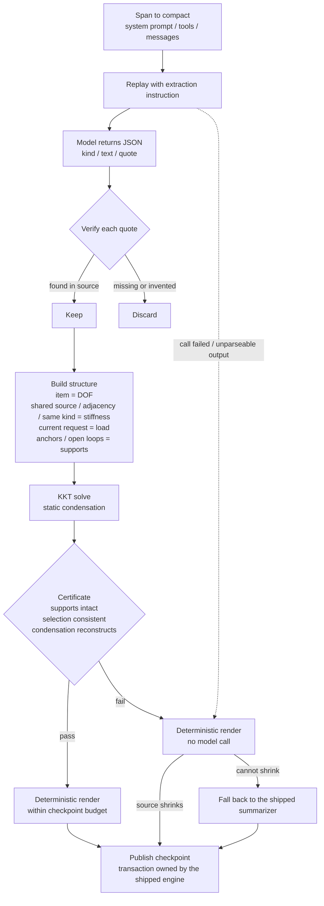

# dsh-compaction-continuum

English | [简体中文](./README.zh-CN.md)

[](./CHANGELOG.md)
[](https://github.com/deepseek-ai)
[](./LICENSE)
[](https://github.com/2718labs/dsh-compaction-continuum/actions/workflows/ci.yml)

A context-compaction backend for DeepSeek Harness, maintained by 2718Labs. The project name is Structural Compression (结构性压缩).

The compaction backend shipped with Harness asks a model to read the history and write a summary, which is then written back into the context. This plugin takes a different route: it extracts items with verbatim citations from the source, computes the load-bearing relations between them, and keeps only the items that are load-bearing and verifiable against the source. The compression ratio is comparable to the shipped backend; the difference is that the published content is traceable.

## Measured results (plugin installed)

The figures below were measured after installing this plugin; the object of measurement is the plugin, not the shipped backend.

Precondition: the self-test reports `backendUsesHookedSummarize: true`, meaning the preset-plane shipped engine instance is already running this compressor.

| Observation | Measured value |
| --- | --- |
| Backend | shipped `BasicCompactionEngine` instance with `summarize` replaced |
| Replayed span | 366 messages (system + 365 shadowed nodes), 41 tools |
| Extraction call | 333,184 cached input / 468 uncached input / 9,954 output tokens |
| Extraction duration | 47.6 s |
| Structural compile | 365 candidates, 46 retained |
| Checkpoint | 2,243 characters, approximately 1,121 tokens (audit recorded 1,076 tokens) |
| Certificate | supports preserved, selection consistent, condensation reconstructs — all true; reconstruction error 0 |
| Fallbacks | none |

On the same span, the shipped backend had previously published a 20,011-character summary (approximately 5,131 tokens). The plugin produced 2,243 characters, every item traceable to a verbatim source quote.

Method and limitations:

- This is a replay measurement: the most recent recorded compaction span in the session is rebuilt and passed through one `summarize` call, reporting actual usage and output, without publishing anything. It therefore measures extraction cost and the checkpoint, not publication cost.
- The replays prefix matched a provider cache entry (333,184 tokens) because that prefix had been sent by real requests before. Whether the cache is still valid depends on the provider's retention policy; with a cold cache the call costs approximately one full prompt read.
- Publication cost requires a real compaction and the request that follows it: run `/compact`, then `node bench/report.mjs`; the event whose `backend` column reads `continuum` is the plugin's real record.

## Shipped backend baseline (reference)

The figures below describe the shipped backend and are included as a design reference. They are not measurements of this plugin.

| Observation | Measured value |
| --- | --- |
| Steady-state prefix-cache hit rate | 99.20% (25 sessions, 3,515 requests) |
| Summarizer input per shipped automatic compaction | approximately 550,000 tokens, billed as uncached input |
| Publication re-read per shipped automatic compaction | approximately 170,000 tokens |
| Cache state of the request preceding each compaction | 99.93% / 99.85% / 99.07% hit, 12.8 s / 0.1 s / 1.1 s earlier |
| Cache hit of the summarizer request | 0 to 9,856 tokens |

This cache behavior follows from a difference between the replayed request and the request actually sent: content assembled at request time is not in the session log, so a replay cannot reproduce it. The same constraint applies to any replay-based summarizer; it is not a functional defect of the shipped backend. The shipped backend's transaction, lock, overflow recovery, retained tail and replay logic are all preserved unchanged by this plugin.

The plugin therefore provides two modes:

- `deterministic`: no model call during compaction, structural selection only. Against the shipped baseline, the additional input drops to approximately 170,000 tokens (about 0.25×).
- `extract`: one model call. The difference from the shipped backend is that every item in the result traces back to the source, and publication is refused when a critical constraint would be lost.

The cost of `extract` mode depends on whether the replayed prefix hits the cache: on a hit it is close to output-only cost (468 uncached input tokens in the measurement above); on a miss it is approximately one full prompt read. Making the cold case cheap as well requires request-time information that the log does not contain; it is not implemented and is listed on the roadmap.

## Output example

The following is a format illustration, using the theme of the test fixture; the shape matches what the renderer emits:

```
## Primary Request and Intent
- Make the static route table in router.ts lazy while keeping /api/health
- User note: do not break the cache hit rate

## Critical Context
- /api/health must stay
- Decision: lazy registration in stages, leave /api/health alone

## Verbatim Anchors
- target file — "G:/proj/src/router.ts"
- E_ROUTE_DUP lives in registry.ts:88 — "E_ROUTE_DUP"
```

Text inside the quotes is verbatim from the source. An item whose quote cannot be located in the source is discarded. The model only selects and copies items; layout, budget control and selection are performed locally.

## How it works



The numbered steps:

1. Replay the history being compacted, together with the system prompt and tool list, to the model, and append an instruction that requests JSON: each item carries a kind, a short summary, and a quote that must appear verbatim in the source.
2. Verify every quote locally. Items that cannot be located, or that were invented, are discarded.
3. Treat the surviving items as degrees of freedom. Shared source, adjacency and same-kind establish stiffness; the current request acts as the load; exact anchors and open loops are pinned as supports.
4. Solve the KKT system and perform static condensation to obtain the load-bearing set.
5. Produce a certificate: whether supports were eliminated, whether the selection is self-consistent, and whether the condensation reconstructs the full response. Any failed check prevents publication.
6. Render the result within the checkpoint budget.

Failures degrade step by step: a failed structural compile falls back to local rendering with no model call; a failed local render falls back to the shipped summarizer. A session is never left without a checkpoint.

## Attachment point

The desktop application places the compaction backend inside each agent preset's isolated scope, so a `compaction` provider mounted on the Host plane is not visible to it. This plugin therefore does not register a second `compaction` provider. It replaces the one extension point the shipped engine publicly exposes: `BasicCompactionEngine.prototype.summarize`. The shipped compaction flow dispatches through that method on every compaction, so replacing it also covers the preset-plane engine, while the shipped transaction, lock, overflow recovery, retained tail and replay logic remain unchanged. The original method is restored when the plugin is unloaded.

The plugin also mounts a Host-plane `compaction` provider for compositions that have no preset plane.

After installation, the self-test reports which engine is active:

```json
"hook": {
  "installedOnShippedClass": true,
  "backendIsShippedClass": true,
  "backendUsesHookedSummarize": true
}
```

## Installation

Requires the desktop Harness with `BasicCompactionEngine` reachable in the composition (verified on `0.2.1-rc.5`).

Install the GitHub bundle with the plugin manager:

```
target: github:2718labs/dsh-compaction-continuum#v0.3.0
```

For a manual installation, add the dependency and the bundle to `~/.dsh/profiles/<profile>/package.json`. The bundle must be listed after `@deepseek-ai/dsh-web-app`:

```json
{
  "dependencies": {
    "dsh-compaction-continuum": "github:2718labs/dsh-compaction-continuum#v0.3.0"
  },
  "dsh": { "profile": { "bundles": ["...", "dsh-compaction-continuum"] } }
}
```

After installation, run `/context_status` in a session, or request `http://127.0.0.1:<port>/compaction-continuum/ping`. The port is the one printed by `dsh web`.

Diagnostics and measurement commands:

```powershell
# Read-only diagnosis; no model call
Invoke-RestMethod 'http://127.0.0.1:<port>/compaction-continuum/selftest' | ConvertTo-Json -Depth 8

# Extraction contract; one small synthetic model call
Invoke-RestMethod 'http://127.0.0.1:<port>/compaction-continuum/selftest?test=extract' |
  Select-Object -Expand probes | Where-Object name -eq 'extraction contract' | Select-Object -Expand value

# Plugin measurement: replay the most recent recorded compaction span; reads and sends that
# session content to the model, publishes nothing
Invoke-RestMethod 'http://127.0.0.1:<port>/compaction-continuum/selftest?test=replay' |
  Select-Object -Expand probes | Where-Object name -eq 'replayed span' | Select-Object -Expand value
```

## Commands

| Command | Description |
| --- | --- |
| `/compact` | Run one compaction immediately. On desktop the preset's own command reaches this compressor; the plugin also registers a same-name fallback. |
| `/context_status` | Reports context size, trigger threshold, the cost of the last compaction and the real cache hit rate. No conversation content is reported. |
| `/context_inspect` | Reports the compaction ledger: cut range, publication cost, structural audit and certificate result. |

Sample `/context_status` output:

```
hook               : installed on @deepseek-ai/dsh-compaction-basic; active engine shipped BasicCompactionEngine (preset plane, hooked)
trigger threshold  : 727040 tokens (ratio 0.8)
current context    : 273740 tokens (26.1% of window, 453300 below trigger)
last audit         : compiled mode=extract units=318 candidates=41 kept=27 checkpoint≈5837 tokens certificate={...}
extractor call     : 312480 cached / 640 uncached input tokens
cache accounting   : 123 requests, hit 99.24% (384347520 cached / 2935624 uncached)
```

## Configuration

The plugin row configures the compressor only. Compaction thresholds and retention are determined by the shipped engine that runs it.

| Key | Default | Description |
| --- | --- | --- |
| `mode` | `extract` | `extract` performs one model call; `deterministic` stays fully local; `off` returns control to the shipped summarizer |
| `extractorMaxTokens` | `12000` | Output cap for the extraction call |
| `checkpointMaxTokens` | `6000` | Checkpoint budget |
| `selectionThreshold` | `0.35` | Load-bearing cutoff relative to the maximum displacement |
| `minKeep` | `8` | Minimum number of items retained |
| `statusCommands` | `true` | Whether to register the commands and loopback diagnostics |
| `maxRecordedCompactions` | `32` | Compaction-ledger entries retained per session |
| `logDecisions` | `true` | Whether compile decisions are logged |

Keys shared with the shipped backend — `thresholdRatio`, `retainTokens`, `maxTokens` and similar — take effect only when this plugin is itself the `compaction` provider. On desktop, the preset engine's policy applies; `/context_status` reports the resolved values.

## Cache accounting

Method and per-event tables are in [the measurement report](./docs/EVIDENCE.md). Summary:

| Observation | Value |
| --- | --- |
| Steady-state cache hit rate (25 sessions / 3,515 requests) | 99.20% |
| Additional input per shipped automatic compaction | approximately 720,000 tokens: about 550,000 for the summarizer's re-read plus about 170,000 for the re-read that any rewrite incurs |
| Summarizer call in those events | matched 0 to 9,856 tokens of its approximately 550,000-token prompt; the preceding request hit above 99% and was 0.1 to 12.8 s old |
| Manual `/compact` after a long idle period | the summarizer call paid 331,799 uncached tokens; the cache had genuinely expired |
| Tool-result pruning | three runs freed 141,041 tokens and forced 1,675,192 additional tokens of reading (about 12×) |

Reproduce on the local machine:

```bash
node bench/report.mjs
```

## Known limitations

- Desktop thresholds and retention come from the preset's shipped engine. Manual `/compact` cuts deeper than automatic compaction (the shipped engine retains 0 for manual compaction).
- When extraction cannot produce verifiable quotes, the checkpoint degrades to deterministic rendering; when that cannot shrink the source, the shipped summarizer runs. Quality therefore depends on the model's citation discipline. The certificate establishes structural self-consistency, not information-theoretic completeness.
- The extraction call cannot reuse the live request cache, so `extract` mode costs the same as the shipped backend. `deterministic` mode skips that call. A replay that is byte-identical to the live request requires request-time information absent from the log; this is not implemented.
- The hook depends on one specific shipped method. If that method is renamed or moved, the plugin silently falls back to the shipped summarizer without breaking the session. Check `hook.backendUsesHookedSummarize` after upgrades.
- The desktop preset still mounts the shipped tool-result pruner. Measurements show it is a net loss, but this plugin does not control that component. Disabling it requires overriding the preset declaration; the trade-off is discussed in `docs/DESIGN.md`.

## Development

```bash
npm run check   # syntax
npm test        # 80 offline assertions, no Harness installation required
node bench/report.mjs   # cache accounting over this machine's session logs
```

Layout:

```
lib/index.js            host side: engine hook, commands, accounting, diagnostics
lib/pipeline.js         extraction → structure → render
lib/structure/core.js   stiffness assembly, KKT solve, static condensation, certificates
bench/                  session-log cost accounting
test/                   offline tests
docs/DESIGN.md          design notes
docs/EVIDENCE.md        measurement report
```

Invariants a pull request must preserve are listed in [CONTRIBUTING.md](./CONTRIBUTING.md).

## Privacy and security

The plugin contains no telemetry, makes no network requests of its own and writes no state to disk. The two loopback diagnostic endpoints are intended for local troubleshooting and contain no conversation content; they can be disabled with `statusCommands: false`. See [SECURITY.md](./SECURITY.md).

## License

[MIT](./LICENSE) © 2026 2718Labs.
