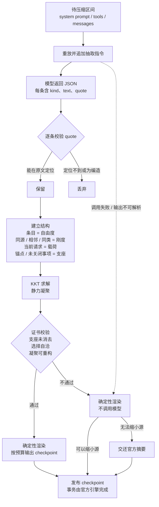

# dsh-compaction-continuum

[English](./README.md) | 简体中文

[](./CHANGELOG.md)
[](https://github.com/deepseek-ai)
[](./LICENSE)
[](https://github.com/2718labs/dsh-compaction-continuum/actions/workflows/ci.yml)

DeepSeek Harness 的上下文压缩后端，中文名「结构性压缩」，英文名 Structural Compression，由 2718Labs 维护。

Harness 自带的压缩由模型阅读历史并生成摘要，再把摘要写回上下文。本插件采用另一种方式：从原文抽取带逐字引文的条目，计算条目之间的承重关系，仅保留承重且可在原文中核验的内容。压缩比例与官方后端相近，区别在于发布内容可追溯。

## 压缩成本的实测结果

测量目的为确定压缩的实际成本构成。数据来源为本机 25 个会话的日志，共 3,515 次请求、997,002,631 prompt token。方法、口径与复现方式见 [测量报告](./docs/EVIDENCE.zh-CN.md)。

结论如下：

- 稳态前缀缓存命中率为 99.20%。长会话的输入成本主要由缓存承担。
- 官方后端每次自动压缩需要额外读取约 55 万 token 的历史，且按未命中输入计费。
- 该额外读取不是缓存过期导致。三次自动压缩前最近一次请求的命中率分别为 99.93%、99.85%、99.07%，间隔 12.8 秒、0.1 秒、1.1 秒；而压缩时的摘要请求只命中开头 0 至 9,856 个 token。

本插件据此提供两种模式：

- `deterministic`：压缩过程不调用模型，仅执行结构筛选。上述三次压缩的额外输入可降至约 17 万 token（约 0.25 倍）。
- `extract`：调用一次模型，成本与官方后端基本持平。区别在于压缩结果逐条可回溯至原文，关键约束丢失时拒绝发布。

`extract` 模式不降低模型调用成本。压缩时的重放请求与实际发出的请求并非逐字节一致，部分只在请求期存在的内容不在会话日志中，因此无法复用前置缓存。这是重放式摘要的固有成本，本插件同样承担。若要使该调用成本接近零，需要取得日志之外的请求期信息，目前尚未实现，列入路线图。

## 压缩产物示例

以下为渲染格式示意（主题取自测试夹具，格式与渲染器实际输出一致）：

```
## Primary Request and Intent
- 把 router.ts 的静态路由表改成惰性注册，保留 /api/health
- 用户提示：别破坏缓存率

## Critical Context
- 必须保留 /api/health
- 决定：分阶段惰性注册，避免改动 /api/health

## Verbatim Anchors
- 目标文件 — "G:/proj/src/router.ts"
- E_ROUTE_DUP 在 registry.ts:88 — "E_ROUTE_DUP"
```

引号内为原文的逐字引用。引文无法在原文中定位时，该条目被丢弃。模型仅负责挑选并抄录条目；排版、预算控制与取舍由本地计算完成。

## 工作机制



流程说明：

1. 将被压缩的历史连同 system prompt 与工具列表重放给模型，末尾追加一条指令，要求输出 JSON：每条包含 kind、摘要与一条必须在原文中逐字出现的 quote。
2. 本地校验每条 quote。无法定位或编造的条目被丢弃。
3. 将保留条目视为自由度，按来源相同、位置相邻、类型相同建立刚度；当前请求作为载荷；精确锚点与未关闭事项固定为支座。
4. 求解 KKT 方程并执行静力凝聚，选出承重集合。
5. 生成证书：支座是否被消去、选择是否自洽、凝聚结果能否重构完整响应。任一校验失败则不发布。
6. 按预算渲染为 checkpoint。

任一步骤失败时逐级降级：结构编译失败则改为纯本地渲染（不调用模型）；本地渲染失败则交还官方摘要。会话不会因压缩失败而缺少 checkpoint。

## 挂载方式

桌面版将压缩后端置于每个 agent preset 的隔离域内，Host 平面挂载的 `compaction` 服务对其不可见。因此本插件不注册第二个 `compaction` 提供者，而是替换官方引擎唯一公开的扩展点 `BasicCompactionEngine.prototype.summarize`。官方压缩流程每次都会动态调用该方法，替换后 preset 平面的引擎同样使用本插件的压缩器；官方的事务、锁、溢出恢复、保留尾部与重放逻辑保持不变。插件卸载时还原原型方法。

插件同时在 Host 平面挂载 `compaction` 提供者，供没有 preset 平面的组合使用。

安装后可通过自检确认实际生效的后端：

```json
"hook": {
  "installedOnShippedClass": true,
  "backendIsShippedClass": true,
  "backendUsesHookedSummarize": true
}
```

## 安装

需要桌面版 Harness，且组合中可取得 `BasicCompactionEngine`（已在 `0.2.1-rc.5` 验证）。

使用插件管理器安装 GitHub bundle：

```
target: github:2718labs/dsh-compaction-continuum#v0.3.0
```

手动安装时，在 `~/.dsh/profiles/<profile>/package.json` 中添加依赖与 bundle。bundle 必须排在 `@deepseek-ai/dsh-web-app` 之后：

```json
{
  "dependencies": {
    "dsh-compaction-continuum": "github:2718labs/dsh-compaction-continuum#v0.3.0"
  },
  "dsh": { "profile": { "bundles": ["...", "dsh-compaction-continuum"] } }
}
```

安装后在会话中执行 `/context_status`，或访问 `http://127.0.0.1:<端口>/compaction-continuum/ping`。端口以 `dsh web` 输出为准。

## 命令

| 命令 | 说明 |
| --- | --- |
| `/compact` | 立即执行一次压缩。桌面端 preset 自带的同名命令会调用本插件的压缩器；插件另注册同名回退命令。 |
| `/context_status` | 输出上下文规模、触发阈值、最近一次压缩成本与真实缓存命中率。不输出对话内容。 |
| `/context_inspect` | 输出压缩账本：切分范围、发布成本、结构审计与证书结果。 |

`/context_status` 输出示例：

```
hook               : installed on @deepseek-ai/dsh-compaction-basic; active engine shipped BasicCompactionEngine (preset plane, hooked)
trigger threshold  : 727040 tokens (ratio 0.8)
current context    : 273740 tokens (26.1% of window, 453300 below trigger)
last audit         : compiled mode=extract units=318 candidates=41 kept=27 checkpoint≈5837 tokens certificate={...}
extractor call     : 312480 cached / 640 uncached input tokens
cache accounting   : 123 requests, hit 99.24% (384347520 cached / 2935624 uncached)
```

## 配置

本插件的行配置仅作用于压缩器。压缩阈值与保留尾部由实际运行压缩的官方引擎决定。

| 键 | 默认值 | 说明 |
| --- | --- | --- |
| `mode` | `extract` | `extract` 调用一次模型；`deterministic` 完全本地；`off` 交还官方摘要 |
| `extractorMaxTokens` | `12000` | 抽取调用输出上限 |
| `checkpointMaxTokens` | `6000` | checkpoint 预算 |
| `selectionThreshold` | `0.35` | 承重判定阈值，相对于最大位移 |
| `minKeep` | `8` | 最少保留条目数 |
| `statusCommands` | `true` | 是否注册命令与回环诊断端点 |
| `maxRecordedCompactions` | `32` | 每会话保留的压缩账条目数 |
| `logDecisions` | `true` | 是否输出编译决策日志 |

`thresholdRatio`、`retainTokens`、`maxTokens` 等与官方后端一致的键，仅在本插件自身作为 `compaction` 提供者时生效。桌面端实际策略来自 preset 引擎，`/context_status` 会报告解析后的值。

## 缓存账

方法与逐事件表格见 [测量报告](./docs/EVIDENCE.zh-CN.md)。摘要如下：

| 观测项 | 数值 |
| --- | --- |
| 稳态缓存命中率（25 会话 / 3,515 请求） | 99.20% |
| 官方自动压缩单次额外输入 | 约 72 万 token，其中约 55 万为摘要调用重读、约 17 万为压缩后必然发生的重读 |
| 上述事件中的摘要调用 | 约 55 万 prompt 中命中 0 至 9,856 token；压缩前最近一次请求命中 99% 以上，间隔 0.1 至 12.8 秒 |
| 长时间空闲后的手动 `/compact` | 摘要调用 331,799 token 全部未命中，属于缓存真实过期 |
| 工具结果剪枝 | 三轮共释放 141,041 token，导致后续请求多读 1,675,192 token（约 12 倍） |

本机复现：

```bash
node bench/report.mjs
```

## 已知限制

- 桌面端的阈值与保留尾部来自 preset 自带的官方引擎。手动 `/compact` 的切割深度大于自动压缩（官方引擎对手动压缩的保留量为 0）。
- 抽取无法产生可核验引文时，退化为确定性渲染；确定性渲染无法缩小源时，交还官方摘要。压缩质量因此受模型的引用纪律约束。证书证明的是结构自洽，不构成信息论意义上的完备性证明。
- 抽取调用无法复用线上请求缓存，`extract` 模式与官方后端成本持平。`deterministic` 模式可跳过该调用。重写与线上请求逐字节一致的重放需要日志之外的请求期信息，目前未实现。
- 钩子依赖一个具体的官方方法。该方法被重命名或迁移时，插件会静默退回官方摘要，不破坏会话。升级后请检查 `hook.backendUsesHookedSummarize`。
- 桌面端 preset 仍挂载官方工具结果剪枝器。实测为净损失，但本插件不控制该组件。禁用它需要覆盖 preset 声明，取舍见 `docs/DESIGN.zh-CN.md`。

## 开发与测试

```bash
npm run check   # 语法检查
npm test        # 80 条离线断言，无需安装 Harness
node bench/report.mjs   # 基于本机会话日志计算缓存账
```

目录结构：

```
lib/index.js            宿主侧：引擎钩子、命令、缓存记账、诊断
lib/pipeline.js         抽取 → 结构 → 渲染
lib/structure/core.js   刚度装配、KKT 求解、静力凝聚、证书
bench/                  会话日志成本核算
test/                   离线测试
docs/DESIGN.zh-CN.md    设计说明
docs/EVIDENCE.zh-CN.md  测量报告
```

PR 需保持的约束见 [CONTRIBUTING.zh-CN.md](./CONTRIBUTING.zh-CN.md)。

## 隐私与安全

插件无埋点、不自主联网、不写入磁盘状态。回环上的两个诊断端点仅用于本地排查，不含对话内容，可通过 `statusCommands: false` 关闭。详见 [SECURITY.zh-CN.md](./SECURITY.zh-CN.md)。

## 许可证

[MIT](./LICENSE) © 2026 2718Labs。
