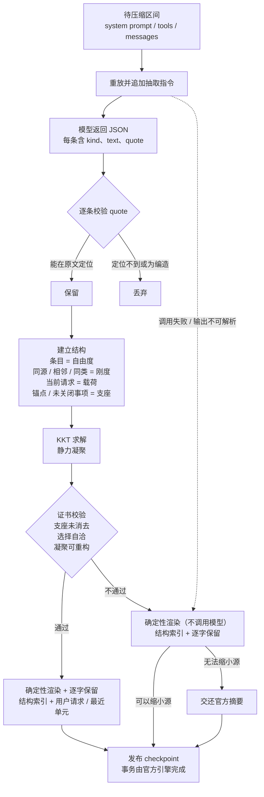

# dsh-compaction-continuum

[English](./README.md) | 简体中文

[](./CHANGELOG.md)
[](https://github.com/deepseek-ai)
[](./LICENSE)
[](https://github.com/2718labs/dsh-compaction-continuum/actions/workflows/ci.yml)

DeepSeek Harness 的上下文压缩后端，中文名「结构性压缩」，英文名 Structural Compression，由 2718Labs 维护。

Harness 自带的压缩由模型阅读历史并生成摘要，再把摘要写回上下文。本插件采用另一种方式：从原文抽取带逐字引文的条目，计算条目之间的承重关系，仅保留承重且可在原文中核验的内容。压缩比例与官方后端相近，区别在于发布内容可追溯。

## 本插件实测结果

以下为安装本插件之后的实测数据，测量对象是本插件，不是官方后端。

前置条件：自检输出 `backendUsesHookedSummarize: true`，即 preset 平面的官方引擎实例已使用本插件的压缩器。

| 观测项 | 实测值 |
| --- | --- |
| 后端 | 官方 `BasicCompactionEngine` 实例，`summarize` 已替换 |
| 重放跨度 | 366 条消息（system + 365 个遮蔽节点），41 个工具 |
| 抽取调用 | 缓存读取 333,184 token / 未命中 468 token / 输出 9,954 token |
| 抽取耗时 | 47.6 秒 |
| 结构编译 | 365 个候选，46 条保留 |
| checkpoint | 2,243 字符，约 1,121 token（审计记录 1,076 token） |
| 证书 | 支座保留、选择自洽、凝聚可重构均为 true；重构误差 0 |
| 降级或回退 | 无 |

同一跨度上，官方后端此前发布的摘要为 20,011 字符（约 5,131 token）。本插件输出 2,243 字符，且每一条都能回溯至原文引用。

该表测量于 v0.3.0，当时逐字保留尚未默认启用。v0.5.0 起 checkpoint 还会附带逐字保留块（见[逐字保留](#逐字保留近无损层)），因此发布体积大于表中的 checkpoint 数值；抽取与结构测量不受影响。

测量方式与限制：

- 该测量为重放测量：重建本会话最近一次压缩的遮蔽段，调用一次 `summarize`，报告实际用量与产物，不发布任何内容。因此它给出抽取成本与 checkpoint，不包含发布成本。
- 本次重放的前缀命中了 provider 缓存（333,184 token），因为该前缀此前由真实请求发送过。缓存是否仍然有效取决于 provider 的保留策略；冷缓存时该调用成本约为一次完整 prompt 读取。
- 发布成本需要在真实压缩后由下一次请求测得。执行 `/compact` 后运行 `node bench/report.mjs`，`backend` 列标为 `continuum` 的事件即为本插件的真实记录。

## 官方后端基线（对照）

以下数据用于说明压缩成本的构成，测量对象是官方后端，仅作设计参照，不是本插件的测量结果。

| 观测项 | 实测值 |
| --- | --- |
| 稳态前缀缓存命中率 | 99.20%（25 个会话、3,515 次请求） |
| 官方后端单次自动压缩的摘要调用输入 | 约 55 万 token，按未命中输入计费 |
| 官方后端单次自动压缩后的发布重读 | 约 17 万 token |
| 压缩前最近一次请求的缓存状态 | 命中 99.93% / 99.85% / 99.07%，距压缩 12.8 秒 / 0.1 秒 / 1.1 秒 |
| 摘要请求的缓存命中 | 0 至 9,856 个 token |

该缓存行为来自重放请求与实际发送请求之间的差异：请求期组装的内容不在会话日志中，重放无法复现。该差异对任何基于重放实现的摘要后端都存在，不构成官方后端的功能缺陷。官方后端的事务、锁、溢出恢复、保留尾部与重放逻辑在本插件中均完整保留。

本插件据此提供两种模式：

- `deterministic`：压缩过程不调用模型，仅执行结构筛选。官方基线中的额外输入可降至约 17 万 token（约 0.25 倍）。
- `extract`：调用一次模型，成本与官方后端基本持平。区别在于压缩结果逐条可回溯至原文，关键约束丢失时拒绝发布。

`extract` 模式的成本取决于重放前缀是否命中缓存：命中时接近只有输出成本（上表实测未命中 468 token），未命中时约为一次完整 prompt 读取。使冷缓存场景也接近零成本需要取得日志之外的请求期信息，目前尚未实现，列入路线图。

## 压缩产物示例

以下为渲染格式示意（主题取自测试夹具，格式与渲染器实际输出一致）：

```
## Primary Request and Intent
- 把 router.ts 的静态路由表改成惰性注册，保留 /api/health
- 用户提示：别破坏缓存率

## Critical Context
- 必须保留 /api/health
- 决定：分阶段惰性注册，避免改动 /api/health

## Verbatim Anchors
- 目标文件 — "G:/proj/src/router.ts"
- E_ROUTE_DUP 在 registry.ts:88 — "E_ROUTE_DUP"
```

引号内为原文的逐字引用。引文无法在原文中定位时，该条目被丢弃。模型仅负责挑选并抄录条目；排版、预算控制与取舍由本地计算完成。

## 工作机制



流程说明：

1. 将被压缩的历史连同 system prompt 与工具列表重放给模型，末尾追加一条指令，要求输出 JSON：每条包含 kind、摘要与一条必须在原文中逐字出现的 quote。
2. 本地校验每条 quote。无法定位或编造的条目被丢弃。
3. 将保留条目视为自由度，按来源相同、位置相邻、类型相同建立刚度；当前请求作为载荷；精确锚点与未关闭事项固定为支座。
4. 求解 KKT 方程并执行静力凝聚，选出承重集合。
5. 生成证书：支座是否被消去、选择是否自洽、凝聚结果能否重构完整响应。任一校验失败则不发布。
6. 按预算渲染为 checkpoint；`## Next Step` 始终有锚点（抽取出的 next_step 条目，或逐字引用最近请求的确定性兜底）。
7. 追加逐字保留块：真实用户请求与最近单元从原文复制，总预算 `verbatimTokens`，并保证 checkpoint 仍小于被替换的区间。

任一步骤失败时逐级降级：结构编译失败则改为纯本地渲染（不调用模型）；本地渲染失败则交还官方摘要。会话不会因压缩失败而缺少 checkpoint。

### 压缩后的连续性

压缩不仅要缩小上下文，还要让后继 agent 能接着做。因此渲染器把 `## Next Step` 视为硬性章节：

- 抽取指令固定要求一条 `next_step` 条目（下一步动作），该条目被固定为结构支座，承重求解不能把它消去。
- 抽取未提供时，渲染器退化为确定性兜底：逐字引用最近一条真实用户请求（剥离请求期脚手架与此前的 checkpoint）；区间内没有用户消息时，引用最近一条助手状态。兜底内容在预算内优先排版。
- 证书记录 `nextStepAnchored`；没有续接锚点的 checkpoint 会被拒绝发布。

兜底是逐字引用，不是模型编造，后继能看到最近一条指令的原文。仍有两个边界。其一，这是结构保证而非信息论保证：它证明续接锚点存在、支座未被消去，不证明任务中的每个事实都保留；多代压缩仍可能丢掉没有任何条目引用的细节。其二，近期消息的保留由官方引擎决定：自动压缩会逐字保留一段尾部，`/compact` 则把整个可见面压成 checkpoint。长任务若依赖细节连续，应依赖自动压缩；`/compact` 应视为一次深度重置。

### 逐字保留（近无损层）

结构 checkpoint 是索引，不是转写稿：它能说明什么承重，却无法还原用户请求的确切措辞。OpenAI Codex 的压缩之所以续接稳定，很大一部分来自把真实用户消息逐字保留（最多 20,000 token），再配一份模型手写交接摘要（[压缩提示词](https://github.com/openai/codex/blob/main/codex-rs/prompts/templates/compact/prompt.md)、[替换历史](https://github.com/openai/codex/blob/main/codex-rs/core/src/compact.rs)）。本插件在不放弃索引的前提下加入同一层：

- 真实用户请求从原文复制，新的在前，不压缩。只剥离请求期脚手架（运行时快照、此前的 checkpoint）。
- 用户请求之后，复制最近的非用户单元（助手消息、工具结果），单个单元有上限，使当前工作集保持可检视。
- `verbatimTokens`（默认 20,000）为两阶段合计预算。截断与省略会在块内标记、计入审计，并由证书字段 `userMessagesVerbatim` 报告。
- 该块会被夹紧，保证发布的 checkpoint 始终小于被替换的区间。

代价是体积：近无损 checkpoint 大致等于保留预算，而不是几千 token；一次性发布重读随之增长。设 `verbatimTokens: 0` 回到早期以压缩率优先的行为。即便启用保留，保留集之外的助手推理与工具输出仍只通过条目存活——精确回退是持久会话日志，而不是 checkpoint 本身。

## 挂载方式

桌面版将压缩后端置于每个 agent preset 的隔离域内，Host 平面挂载的 `compaction` 服务对其不可见。因此本插件不注册第二个 `compaction` 提供者，而是替换官方引擎唯一公开的扩展点 `BasicCompactionEngine.prototype.summarize`。官方压缩流程每次都会动态调用该方法，替换后 preset 平面的引擎同样使用本插件的压缩器；官方的事务、锁、溢出恢复、保留尾部与重放逻辑保持不变。插件卸载时还原原型方法。

插件同时在 Host 平面挂载 `compaction` 提供者，供没有 preset 平面的组合使用。

安装后可通过自检确认实际生效的后端：

```json
"hook": {
  "installedOnShippedClass": true,
  "backendIsShippedClass": true,
  "backendUsesHookedSummarize": true
}
```

## 安装

需要桌面版 Harness，且组合中可取得 `BasicCompactionEngine`（已在 `0.2.1-rc.5` 验证）。

使用插件管理器安装 GitHub bundle：

```
target: github:2718labs/dsh-compaction-continuum#v0.5.0
```

手动安装时，在 `~/.dsh/profiles/<profile>/package.json` 中添加依赖与 bundle。bundle 必须排在 `@deepseek-ai/dsh-web-app` 之后：

```json
{
  "dependencies": {
    "dsh-compaction-continuum": "github:2718labs/dsh-compaction-continuum#v0.5.0"
  },
  "dsh": { "profile": { "bundles": ["...", "dsh-compaction-continuum"] } }
}
```

安装后在会话中执行 `/context_status`，或访问 `http://127.0.0.1:<端口>/compaction-continuum/ping`。端口以 `dsh web` 输出为准。

自检与实测命令：

```powershell
# 只读诊断：不调用模型
Invoke-RestMethod 'http://127.0.0.1:<端口>/compaction-continuum/selftest' | ConvertTo-Json -Depth 8

# 抽取契约：一次很小的合成模型调用
Invoke-RestMethod 'http://127.0.0.1:<端口>/compaction-continuum/selftest?test=extract' |
  Select-Object -Expand probes | Where-Object name -eq 'extraction contract' | Select-Object -Expand value

# 本插件实测：重放会话中最近一次压缩跨度；会读取并发送该段会话内容给模型，不发布
Invoke-RestMethod 'http://127.0.0.1:<端口>/compaction-continuum/selftest?test=replay' |
  Select-Object -Expand probes | Where-Object name -eq 'replayed span' | Select-Object -Expand value
```

## 命令

| 命令 | 说明 |
| --- | --- |
| `/compact` | 立即执行一次压缩。桌面端 preset 自带的同名命令会调用本插件的压缩器；插件另注册同名回退命令。 |
| `/context_status` | 输出上下文规模、触发阈值、最近一次压缩成本与真实缓存命中率。不输出对话内容。 |
| `/context_inspect` | 输出压缩账本：切分范围、发布成本、结构审计与证书结果。 |

`/context_status` 输出示例：

```
hook               : installed on @deepseek-ai/dsh-compaction-basic; active engine shipped BasicCompactionEngine (preset plane, hooked)
trigger threshold  : 727040 tokens (ratio 0.8)
current context    : 273740 tokens (26.1% of window, 453300 below trigger)
last audit         : compiled mode=extract units=318 candidates=41 kept=27 checkpoint≈5837 tokens nextStep=atom retained=12u/8r (19880 tokens) certificate={...}
extractor call     : 312480 cached / 640 uncached input tokens
cache accounting   : 123 requests, hit 99.24% (384347520 cached / 2935624 uncached)
```

## 配置

本插件的行配置仅作用于压缩器。压缩阈值与保留尾部由实际运行压缩的官方引擎决定。

| 键 | 默认值 | 说明 |
| --- | --- | --- |
| `mode` | `extract` | `extract` 调用一次模型；`deterministic` 完全本地；`off` 交还官方摘要 |
| `extractorMaxTokens` | `12000` | 抽取调用输出上限 |
| `checkpointMaxTokens` | `6000` | 结构 checkpoint 预算 |
| `verbatimTokens` | `20000` | 用户请求与最近单元的逐字保留预算；`0` 关闭近无损层 |
| `selectionThreshold` | `0.35` | 承重判定阈值，相对于最大位移 |
| `minKeep` | `8` | 最少保留条目数 |
| `statusCommands` | `true` | 是否注册命令与回环诊断端点 |
| `maxRecordedCompactions` | `32` | 每会话保留的压缩账条目数 |
| `logDecisions` | `true` | 是否输出编译决策日志 |

`thresholdRatio`、`retainTokens`、`maxTokens` 等与官方后端一致的键，仅在本插件自身作为 `compaction` 提供者时生效。桌面端实际策略来自 preset 引擎，`/context_status` 会报告解析后的值。

## 缓存账

方法与逐事件表格见 [测量报告](./docs/EVIDENCE.zh-CN.md)。摘要如下：

| 观测项 | 数值 |
| --- | --- |
| 稳态缓存命中率（25 会话 / 3,515 请求） | 99.20% |
| 官方自动压缩单次额外输入 | 约 72 万 token，其中约 55 万为摘要调用重读、约 17 万为压缩后必然发生的重读 |
| 上述事件中的摘要调用 | 约 55 万 prompt 中命中 0 至 9,856 token；压缩前最近一次请求命中 99% 以上，间隔 0.1 至 12.8 秒 |
| 长时间空闲后的手动 `/compact` | 摘要调用 331,799 token 全部未命中，属于缓存真实过期 |
| 工具结果剪枝 | 三轮共释放 141,041 token，导致后续请求多读 1,675,192 token（约 12 倍） |

本机复现：

```bash
node bench/report.mjs
```

## 已知限制

- 桌面端的阈值与保留尾部来自 preset 自带的官方引擎。手动 `/compact` 的切割深度大于自动压缩（官方引擎对手动压缩的保留量为 0）。
- 抽取无法产生可核验引文时，退化为确定性渲染；确定性渲染无法缩小源时，交还官方摘要。压缩质量因此受模型的引用纪律约束。证书证明的是结构自洽，不构成信息论意义上的完备性证明。
- 抽取调用无法复用线上请求缓存，`extract` 模式与官方后端成本持平。`deterministic` 模式可跳过该调用。重写与线上请求逐字节一致的重放需要日志之外的请求期信息，目前未实现。
- 钩子依赖一个具体的官方方法。该方法被重命名或迁移时，插件会静默退回官方摘要，不破坏会话。升级后请检查 `hook.backendUsesHookedSummarize`。
- 桌面端 preset 仍挂载官方工具结果剪枝器。实测为净损失，但本插件不控制该组件。禁用它需要覆盖 preset 声明，取舍见 `docs/DESIGN.zh-CN.md`。

## 开发与测试

```bash
npm run check   # 语法检查
npm test        # 110 条离线断言，无需安装 Harness
node bench/report.mjs   # 基于本机会话日志计算缓存账
```

目录结构：

```
lib/index.js            宿主侧：引擎钩子、命令、缓存记账、诊断
lib/pipeline.js         抽取 → 结构 → 渲染
lib/structure/core.js   刚度装配、KKT 求解、静力凝聚、证书
bench/                  会话日志成本核算
test/                   离线测试
docs/DESIGN.zh-CN.md    设计说明
docs/EVIDENCE.zh-CN.md  测量报告
```

PR 需保持的约束见 [CONTRIBUTING.zh-CN.md](./CONTRIBUTING.zh-CN.md)。

## 隐私与安全

插件无埋点、不自主联网、不写入磁盘状态。回环上的两个诊断端点仅用于本地排查，不含对话内容，可通过 `statusCommands: false` 关闭。详见 [SECURITY.zh-CN.md](./SECURITY.zh-CN.md)。

## 许可证

[MIT](./LICENSE) © 2026 2718Labs。
